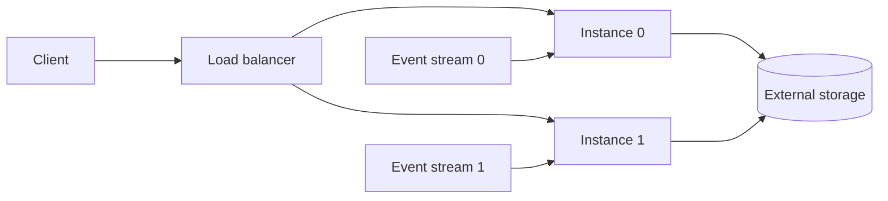
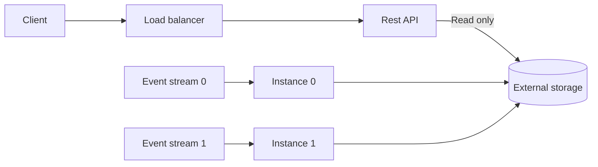

# Chapter 13. Integrating Event-Driven and Request-Response Microservices

- Collecting metrics from external sources, such as an application on user's cell phone, or IoT devices.
- Integrating with existing request-response applications.
- Serving content is real time to web.
- Serving dynamic requests based on real-time information such as location, time, and weather.

The term request-reponse services refers to services that communicate with each other directly, 
through a synchronous API.
For example: 2 services communicating via HTTP.

# Handling External Events

External events are sent from the outside via a request-reponse API.

While it is possible to expose an event broker to an external client, but it is unreasonable to do.
We need to solve access issues and security issues.

There are two main types of externally generated events to consider.

## Autonomously Generated Events

Events are sent from client to server by your products.

These requests are usually defined as a metric or measurement from the product, such as
information about activity, sensor readings.

Analytical events.

Any request from an product, based on actions originating from that product, counts as an external generated event.

## Reactively Generated Events

A reactive event is generated in response to a request from one of your services.

The request is received and the client doesn't need any other details from the response.

For example, you use a 3rd party service to send an email.

Collecting the response and converting them into events may not be necessary if thre is no action to take from the results.

On the other hand, the business may need the reponse of the request.
For example, the response from the 3rd party payment API. This data is important to put into an event stream, as it allows
downstream accounting services.

## Handling Autonomously Generated Analytical Events

Analytical events may be bundled together and sent:
- batch
- when they occur

Client --Send events--> Request-response endpoint --Publish events--> Event streams

Schematized events at scale:
- versioning
- evolution

> Problems when ingesting analytical events from devices running multiple versions of code.
Old application running on an mobile app. Adding new fields to collect new data.
Solution: force users to upgrade the application by locking out older versions.
Plan for multiple versions in a big update.

Think of external event sources as a set of microservice instances.

It's important to sort the incoming events into defined event streams based on schemas and definitions.

## Integrating with Third-Party Request-Response APIs

Need to communicate with 3rd APIs via request-response protocols.

Treat the request and response as a `remote function call`.

1. The microservice calls the API and awaits the reply.
2. Parse the result and continue business logic.

Input event stream --> Consumer send a request --> 3rd endpoint --> Consumer parse response --> Result event stream.

```cs
var event = consumer.ConsumeOne("input-event-stream");
var request = generateHttpRequest(event);
var response = await externalHttpClient.Get(request);

if (response.OK) {
    var payment = response.ParseJson<PaymentResponse>();
    var outEvent process(payment);
    producer.Produce("output-event-stream", outputEvent)
} else {
    // 1. Retry
    // 2. Log
    // 3. Skip
    // 4. etc
}
```

Some benefits of this pattern:
- Mix event processing with request-response aPI
- Call what ever external APIs
- Nonblocking, you only need to wait for the results.

Drawbacks:
- Making requests to an external service introduces non-deterministic elements.
- Marking changes to the API can cause the microservice to fail.
- Consume and process events as fast as they can. The remote service may block incoming because of the large traffic.

# Processing and Serving Stateful Data

The microservice consumes events from input event streams, processes them and stores state internally or externally.

## Serving Real-Time Requests with Internal State Stores

Serve the results from internal state.

Request --> Load balancer --> Microservice A --> Materialized table --> Response
                              Microservice B

It is common that multiple microservice instance are required.
You must route requests to the correct instance.

1. The client make a request.
2. The load balancer routes the request to `Instance 0`
3. The Instance 0 check the key in metadata, it doesn't have data so it forward the request to Instace 1.
4. Instace 1 handles the request and send the reponse back.

> TIP
> 1 partition belongs 1 instacne that has a materialized table.

## Serving Real-Time Requests with External State Stores

Advatages:
- All state is avaialbe to each instance, the request does not need to be forwarded to other.
- Consumer group rebalances don't require to rematerialize the internal state in the new instance.

Each microservice instance can serve the entire domain of keyed data from the state store. 



Serving requests via the materializing event-driven microservice

Serving requests via a separate microservice.
The request-response API is completely separate from the executable of the event-driven microservice that materializes
the state to the external store. 
Separete the API and the event processor



Advantes:
- You can choose any langauges for the REST API.
- Isolating any failures in the event processing  logic from the request-response application.

Disadvantes:
- More complexity.

This pattern is still a useful pattern for serving data and it is often sucessfully used in production.

# Handling Requests Within an Event Driven workflow

The basic of communication between many systems.

- Perform the requesed operation immediately and return the response to the client.
- Convert the request into an event.

Handling requests directly (the traditional way) vs turning them into events first.

## Processing Events for User Interfaces

Application designs that process requests as events must incorporate an `asynchronous UI`.

For example:
- In synchronous UI, a user who clicks a button may expect to receive a failure or success in 100ms or less.
- In asynchronous UI, a user who clicks a button may expect to receive a failure or success in longer 100ms or less.

There are some asynchronous UI techniques.
For example, you can update the UI to indicate that the request has been sent, disable the button, show `please wait` text.

Example: convering requests directly to events to processing.
Newspaper publishing workflow (approval pattern)

A newspaper publisher has an application that manages the layout.
Each publication relies customizalbe template.
A GUI allows the newspaper designers to arrange and palce articles.

2 bounded context
- The design.
- The approval of the newspaper.

The newspaper populator microservice.
It is reponsible for layout tasks.
When the newspaper is ready for approval, they compile it into a PDF, save it to an external store
and produce an event to `Populated newspaper stream`.

```cs
// Populated newspaper event

Key: string pn_key          // Populated newspaper key
Value: {
    string pdf_uri          // Location of the stored PDF
    int version             // Version of the populated newspaper
    Pages[] page_metadata   // Metadata about what is on each page
        - int page_number
        - enum content      // Ad, article
        - string id         // ID of the ad or article
}
```

```cs
// Editor approval event
Key: string pn_key              // Populated newspaper key
Value: {
    string marked_up_pdf_uri    // Optional URI of the marked-up PDF
    int version                 // Version of the populated newspaper
    enum status                 // awaiting_approval, approved, rejected
    string editor_id
    string editor_comments 
    RejectedAdvertisements[] rejectedAds // Optional, if rejected
        - int page_number
        - string advertisement_id
        - string advertiser_id
        - string advertiser_comments
}
```

```cs
// Advertiser approval event

Key: string pn_key              // Populated newspaper key
Value: {
    string advertiser_pdf_uri   // The PDF piece shown to the advertiser
    int version                 // Versionn of the populated newspaper
    int page_number
    boolean approved            // Approved or not
    string advertisement_id
    string advertiser_id        // ID of the approver
    string advertiser_comments
}
```

One of the benefit of having populated events is no need to create an external state store.

## Separating the editor and advertiser approval services

The editor approval service.
    - Approving layout, design, flow
    - Accessing the summary
    - Providing suggestions to the desginer

The advertiser approval service.
    - Which ads to asked for approval
    - Managing ads, controls, brands

## Micro-Frontends in Request-Response Application

A microfroneds approach aligns completely on business concers from backend to frontend.

3 ways
1. The monolithic backend approach.

Frontend ---> Backend

2. The microservice backend approach.

Frontend ---> Aggregation layer --> Microservice A
                                       Microservice B
                                       Microservice C

3. The microfrontend

Frontend A ---> Microservice A
Frontend B ---> Microservice B
Frontend C ---> Microservice C

Benefits of microfrontends:
- Matching up with event-driven microservice backends.
- Composition-Based Microservices
- Easy Alignment to Business Requirements

Drawbacks of Microfrontends
- Potentially consistent UI elements and styling
- Varying Microfrontend performance