# CHAPTER 1. SCALE FROM ZERO TO MILLIONS OF USERS

Design a system supporting millions users is a challenge.

## Single serve setup

Everthing is running on a single server.

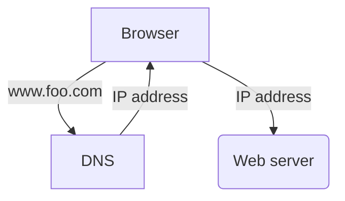

1. Users access websites by domain names.
2. IP address is returned.
3. Make a HTTP request by using IP.
4. The web server returns HTML pages or JSON response.

## Database

With the growth of the user base.
We need to multiple server.
One fore web traffic, the other for the database.

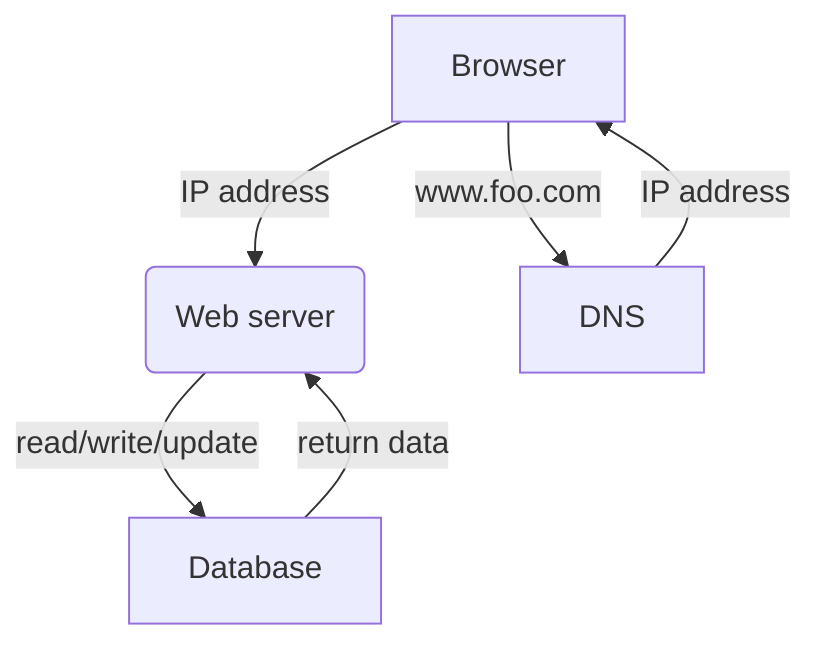

## Which database to use

RDBMS

- They work well.

NoSQL

- The application requires super-low latency.
- Data are unstructured.
- Only need to serialize and deserialize data (JSON, YAML, XML).
- Need to store a massive amount of data.

## Vertical scaling vs horizontal scaling

Vertical scaling means adding more CPU, RAM to servers.

Limitations:

- Adding CPU, RAM to a single server is limited.
- Vertical scaling does not have failover. If the server goes down, the website goes down.

Horizontal scaling solves vertical scaling's limitations.

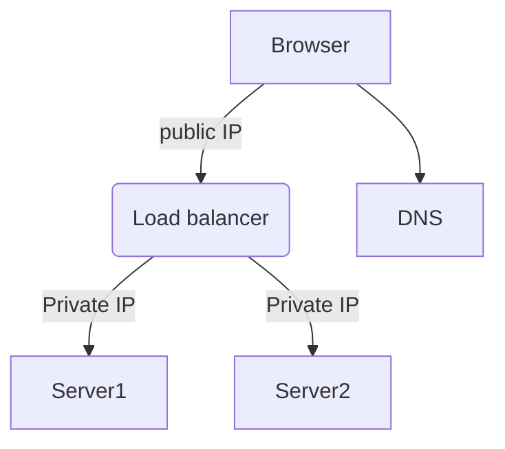

The load balancer solves no faiover issue.
- If server 1 goes offline, all the traffic will be routed to server 2.
- If the traffic grows, you can add more servers.

## Database replication

One database, you have no failover.

If you use database replication, you can have failover.

A master database only supports write operations.
A slave database that gets copies of the data from the master database only supports read operations

The commands like insert, update, delete must be sent to the master database.
The query command must be sent to the slave database.

The ratio of reads is normaly higher than the ratio of writes.
Thus the number of slave databases is lager than the number of master databases.

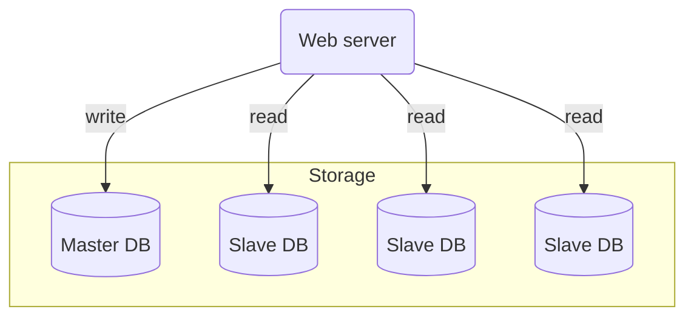


Advantages of database replication:
- Better performance: Read operations are distributed across slave nodes.
- Reliability: You do not worry about data lost if a node is destroyed.
- HA: If a database is offline, you can access in another database server.

If only one slave database is avilable and it goes offine,
read operations will be directed to the master database.

If the master database goes offline, a slave will be promoted to the new master.

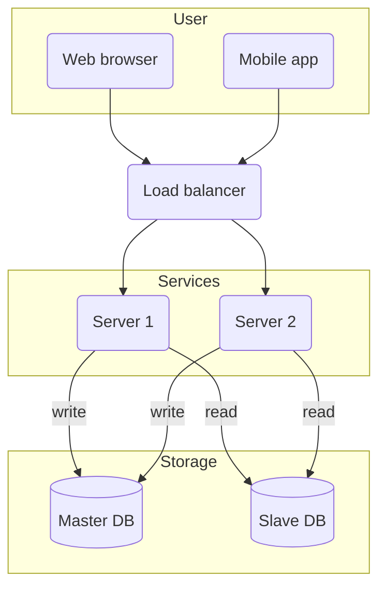

## Cache

Improve the load/response time.

A cache can improve the system performance by reducing database worload. 

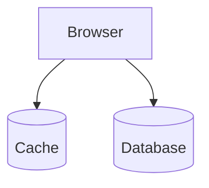

## Consideration for using cache

- Data is read frequently but modified infrequently.
- Expiration policy, reloading data too frequently, data become stale.
- Consistency data store and the cache in sync.
- Eviction policy: LRU, LFU, FIFO.

## Content delivery network (CDN)

A CDN is a server used to deliver static content.
CDN servers cache static content like images, CSS, video, etc.

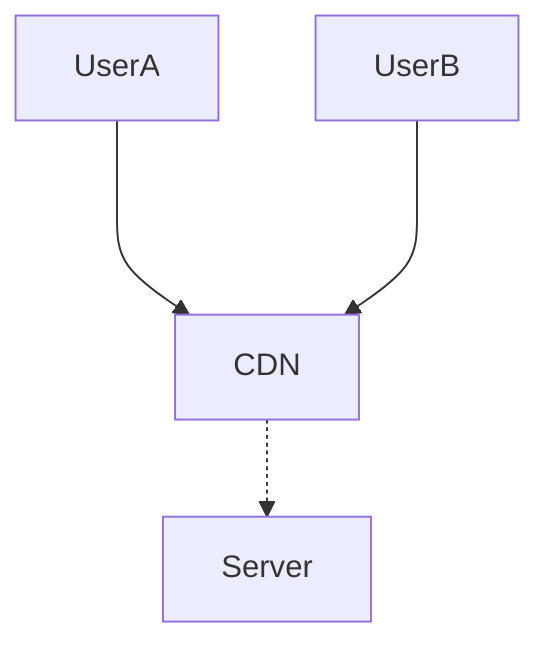

## Consideration of using a CDN

- Cost: CDNSs are run by 3rd party providers.
- Cache expiry.
- CDN fallback: if CDN outage, clients should be able to request resources from the origin.
- Invalidating files.

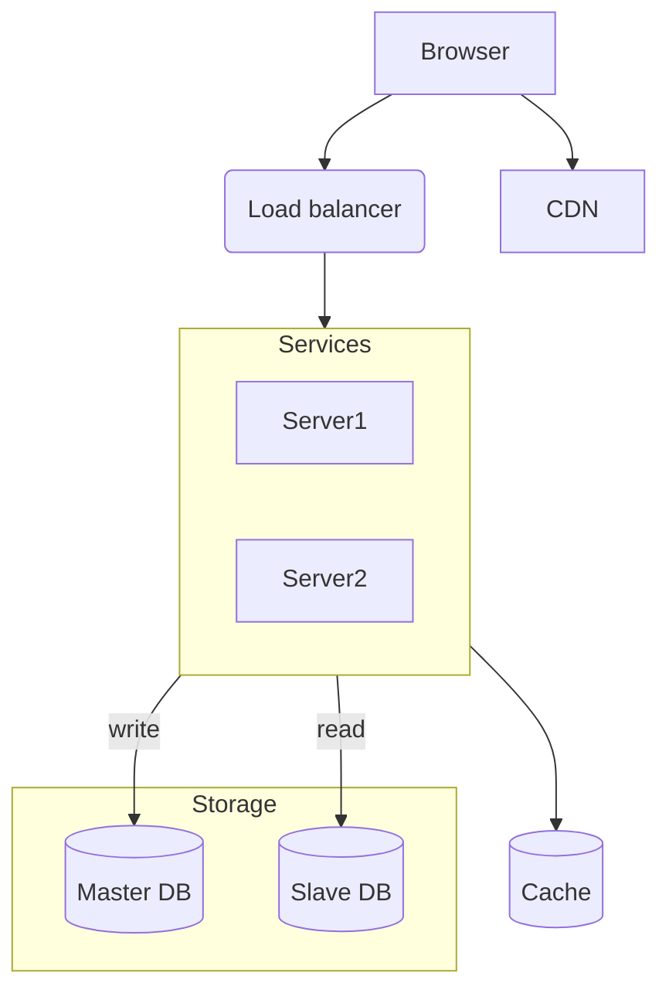

## Stateless web tier

We need to move state out of the web tier.
A good practice is to store session data in the storage such database or NoSQL.

## Stateful architecture

A stateful server remebers client data (state) from one request to the next.

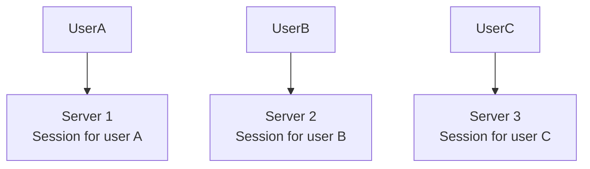

## Staless architecture

A staless server doesn't store any state information.

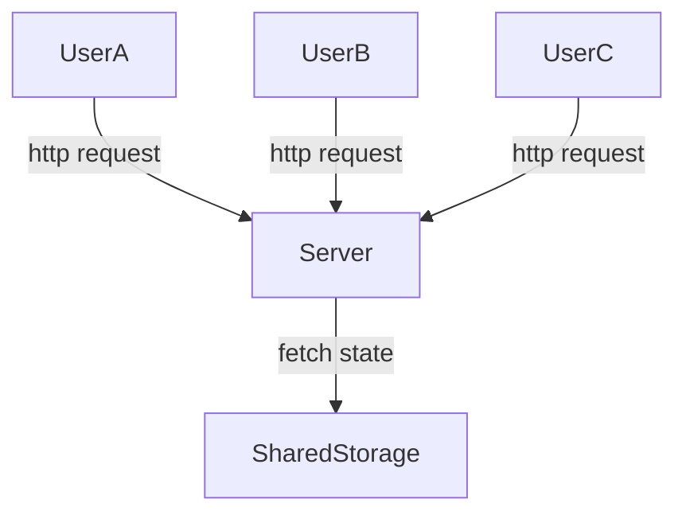

Updated design with a stateless web tier.

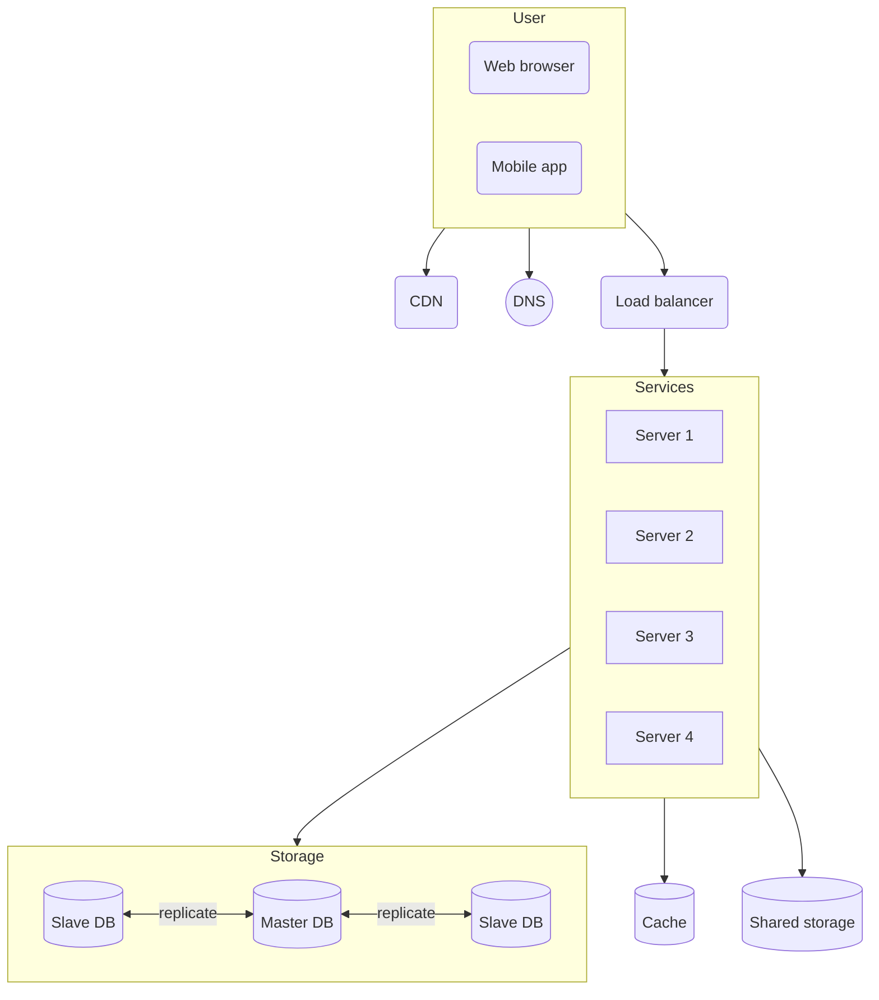

## Data centers

Split traffic based on geoDNS.

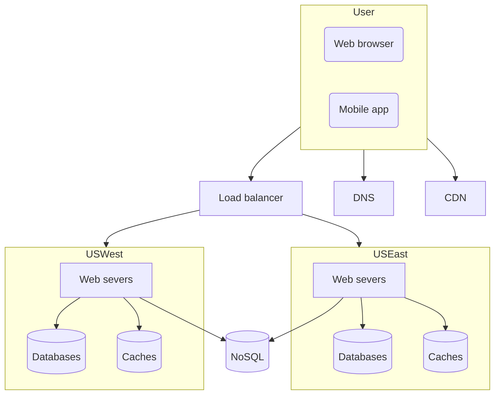

## Message Queue

A message queue is a durable component, stored in memory, that supports asynchronous communication.

Decoupling, a producer can post a message to the queue when the consumer is unavailable to process it.

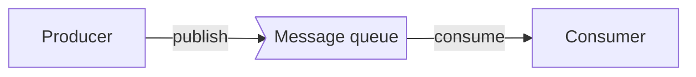

## Logging, metrics, automation

Logging: monitoring error logs

Metrics: collecting different types of metrics

Adding message queues and differetn tools.


```mermaid
flowchart
subgraph User
    UI(Web browser)
    App(Mobile app)
end

subgraph DC1
    Servers(Web servers)
    Caches[(Caches)]
    Databases[(Databases)]
    MQ>Message queue]
    Workers

    Servers --> Caches & Databases & MQ
    MQ --> Workers
end

subgraph Tools
    Logging -.- Metrics
    Monitoring -.- Automation
end

LB(Load balancer)
NoSQL[(NoSQL)]

User --> LB & CDN & DNS
LB --> DC1
Servers --> NoSQL
Tools --> DC1